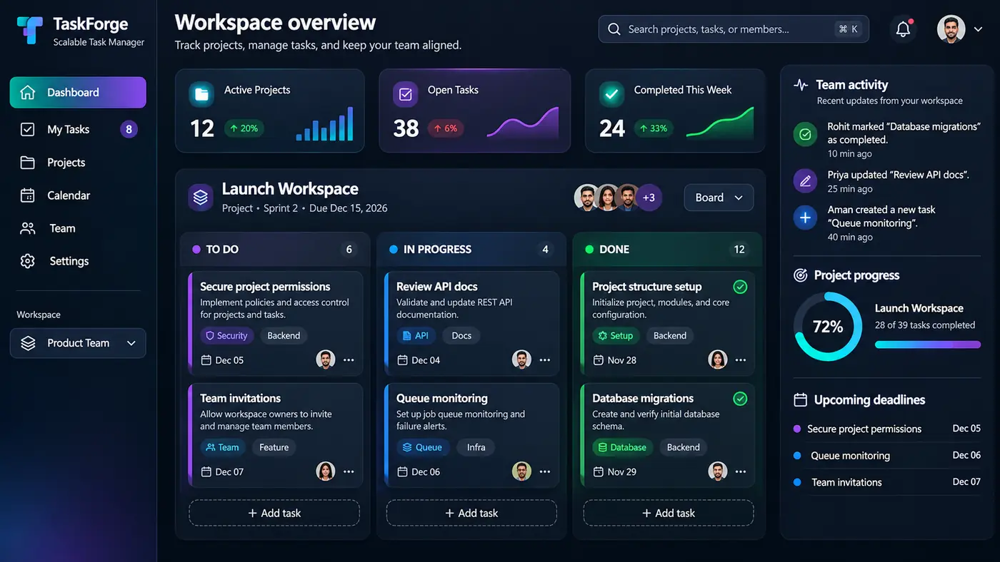

# TaskForge · Scalable Task Manager

> A Laravel-based project and task management application built to explore maintainable backend architecture, secure collaboration, queues, and real-time workflows.

[](https://laravel.com)
[](https://www.php.net)
[](LICENSE)


## Dashboard design preview



> **Design concept, not a screenshot of working software.** This visual illustrates the planned workspace overview, Kanban task board, progress tracking, team activity, and responsive interface. Actual application pages and screenshots will be added as features are implemented and tested.

**Project status:** Work in progress. The `main` branch is the public project landing page; **[the Laravel application source is on the `development` branch](https://github.com/pravin99c/scalable-task-manager/tree/development)**. This software has not yet completed its security review, reproducible build verification, performance benchmarking, or release testing. **Do not deploy it as a public production service yet.**

## What the development branch contains

| Area | Existing source code | Work remaining |
| --- | --- | --- |
| Laravel API | Auth, projects, tasks and comments controllers | Resource authorization, workspace scoping and API consistency |
| Application architecture | Service and repository classes | Consistent data contracts, pagination and transactional workflows |
| Admin interface | Blade-based administration pages | RBAC consistency, modern UX and access-control tests |
| Data | Eloquent models, migrations, factories and seeders | Migration validation, indexing and safe demo account setup |
| Async workflows | Queue job and task-update event | Actual notification delivery, job retries and event authorization |
| Development tooling | Docker Compose files and PHPUnit tests | One verified install path, CI and expanded automated coverage |

Descriptions above document **code present in the branch**, not guarantees that every capability currently works.

## Explore the project

- **[Application source](https://github.com/pravin99c/scalable-task-manager/tree/development)** — Laravel app, API routes, models, services, views and tests.
- **[Development branch README](https://github.com/pravin99c/scalable-task-manager/blob/development/README.md)** — existing technical notes (some claims require verification).
- **[Implementation roadmap](docs/ROADMAP.md)** — practical phases, security priorities and release criteria.
- **[Contributing guide](CONTRIBUTING.md)** — how to propose improvements safely.

## Proposed architecture

```text
Browser (current Blade admin; planned React/TypeScript UI)
              |
       Laravel + Sanctum
              |
      Controllers / Policies
              |
        Domain services
          /       \
       MySQL     Redis
                  |
             Queue workers
       (and authorized events)
```

**Technical direction:** Laravel + PHP, MySQL, Redis, Sanctum, Laravel Horizon, authorized real-time broadcasting, and Docker-based development. Future React/TypeScript work will follow security and API stabilization.

## Local evaluation

The existing application has not been validated in a fresh environment during this review. To inspect it:

```bash
git clone https://github.com/pravin99c/scalable-task-manager.git
cd scalable-task-manager
git switch development
```

Inspect the `composer.json`, `.env.example`, `compose.yaml` and `docker-compose.yml` before starting. The development branch currently contains two Compose configurations; standardizing them and publishing a **tested** setup guide is an initial roadmap task. Never expose the current development build to the public internet.

## Help improve TaskForge

Code review, tests, accessibility improvements, documentation suggestions and reproducible setup reports are welcome. See [CONTRIBUTING.md](CONTRIBUTING.md). Please **do not post security vulnerabilities or credentials in public issues**.

If you find the project direction helpful, consider starring the repository to follow its progress. Stars are appreciated, but verified releases and clear documentation come first.

## License

MIT — see [LICENSE](LICENSE).
